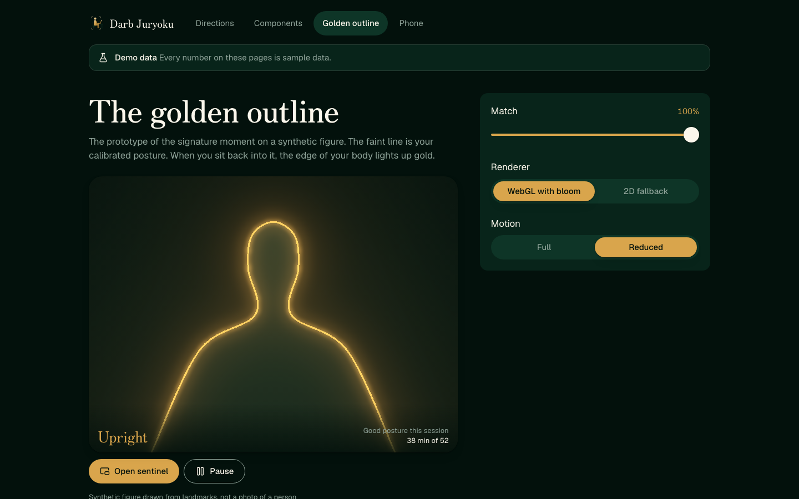
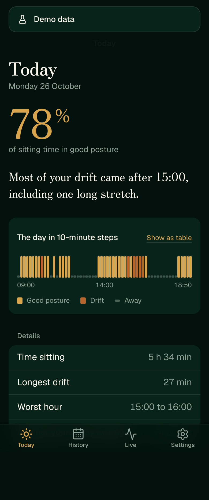

# Darb Juryoku

A webcam app that runs in the browser while you code. MediaPipe tracks your neck and shoulders, and a small PyTorch model trained on **your own** good and bad posture decides when you are slouching. You get a gentle nudge in the moment and an honest daily report at the end of the day.

Everything runs on your device. Webcam frames never leave the browser, and there is no cloud backend.

**Signature moment:** a faint golden outline of your ideal posture sits over the live video. When your body matches it, your silhouette glows gold. In Darb Budokai, good posture refills your character's stamina.

Darb Budokai role: **Stamina** (region: The Springs, stat: Vigor).

Status: Phases 0 to 3 are done (28%): repo bootstrap, the product spec (`docs/specs/2026-10-26-phase-01-product-spec.md`), the design system and a clickable prototype of every screen on demo data. Next: Phase 4, the live camera and pose pipeline with the heuristic.



---

## Stack

| Layer | Choice |
|---|---|
| Pose estimation | MediaPipe Tasks Vision `PoseLandmarker` (web, `@mediapipe/tasks-vision` 0.10.x), self-hosted model and WASM files |
| Posture model | PyTorch 2.x (2.8 or newer) classifier on landmark windows, exported to ONNX |
| In-browser inference | ONNX Runtime Web (`onnxruntime-web` 1.22 or newer), WebGPU with a WASM fallback, running in a Web Worker |
| Frontend | Vite 7, React 19, TypeScript 5.9, Tailwind CSS 4, Motion 12, WebGL2 shader for the glow |
| Local storage | IndexedDB through Dexie 4 (sessions, daily stats, landmark recordings) |
| Training pipeline | Python 3.12, uv, PyTorch, scikit-learn (metrics), DVC 3 (datasets and pipeline), DVCLive (experiments) |
| Tests | Vitest 3, Playwright + `@axe-core/playwright`, pytest 8 |
| Hosting | Static site on the Vercel free tier (decided in Phase 1; deploying waits for launch). Cost: $0/month. |

Exact versions are pinned in Phase 0 to the latest stable release on that day.

## Folder map (after Phase 0)

```
darb-juryoku/
├── apps/web/              Vite + React app (the product)
├── packages/schemas/      JSON Schemas: events, runtime config, dataset manifest
├── ml/                    Python training pipeline (uv project)
├── config/                Runtime config YAML (thresholds, nudge copy, report rules)
├── data/                  DVC-tracked datasets (contents git-ignored)
├── models/                DVC-tracked trained models and model cards
├── eval/                  Committed evaluation and latency reports (JSON)
├── dvc.yaml, params.yaml  Training pipeline stages and hyperparameters
└── docs/                  This planning package, then specs, plans and the ledger
```

This planning folder holds:

```
README.md          this file
CLAUDE.md          the agent operating manual (rules, workflow, commands)
AGENTS.md          short pointer to CLAUDE.md
docs/VISION.md         intent, goals, non-goals, anti-goals, why this stack
docs/ARCHITECTURE.md   components, data flow, storage, ML pipeline, testing
docs/UI_DESIGN.md      signature moment, screens, motion, art directions
docs/INTEGRATION.md    events for Darb Budokai and the optional integration phase
docs/PLAN.md           phases 0 to 11, from 0% to 100%
docs/PROGRESS.md       the ledger
docs/DECISIONS.md      ADR log
docs/OPEN_QUESTIONS.md the 20 Phase 1 questions and their answers
docs/specs/            approved phase specs
docs/CONVENTIONS.md    code style, layout, tests, commits, PR template
```

## Design system

Night Instrument on the approved brand (Zen Old Mincho and Geist; night, forest and gold), with an Ivory light theme. Tokens live in `config/design/tokens.yaml` and generate the CSS; every text and mark colour pair is contrast-tested in both themes. Run the app and open `/design` (the three directions side by side), `/design/components` (every component and state), `/design/overlay` (the golden outline, WebGL with a 2D fallback) and `/design/mobile` (the phone shell). Screenshots are in `docs/screenshots/phase-02/`.

## The prototype

Every screen runs in demo mode on a synthetic sitter's three weeks (`config/seed/demo/`, generated from a recipe with an afternoon slump and a Friday drop): the live mirror with the golden outline and a gentle nudge, Today and past days, History with the hour by weekday heatmap and streaks, Calibrate, the always-on-top sentinel (Document Picture-in-Picture), Nudges, Welcome with the privacy diagram, Dataset Studio, Model Lab (confusion matrix, release gates, model against the heuristic, latency) and Settings. Open `/?demo=1`; `?demo=0` returns to real mode. Every string is in `config/copy/en.yaml`. Screenshots, phone and desktop in both themes, are in `docs/screens/phase-03/`.



## Run it locally

Requirements: Node 24 or newer, pnpm 11, Python 3.12 with uv, bats-core.

```bash
pnpm install
pnpm --filter web dev            # http://localhost:5173 (cross-origin isolated); add ?demo=1 for demo data
pnpm check:all                   # every unit test, lint, typecheck, schema, emoji and hook check
pnpm --filter web e2e            # Playwright smoke and axe scan against the production build
uv sync --project ml && pnpm ml:test
```

Work proceeds phase by phase from `docs/PLAN.md`; `docs/PROGRESS.md` is the ledger.

## How it fits the universe

Darb Juryoku is the **Stamina** source for [Darb Budokai](../darb-budokai/), the RPG that Nour's real life powers. At the end of each sitting it can send one `posture.session.recorded` v1 event (minutes of good and bad posture, never images or landmarks) to Darb Budokai's ingest API. Darb Budokai turns good minutes into stamina and Vigor XP.

Darb Juryoku does not need Darb Budokai to work. The integration is an optional later phase (see `docs/INTEGRATION.md`). Darb Kaioken will later embed a reader-facing demo of the live outline, and Darb Enmacho reads the same events from Darb Budokai.

## Licence

Code is MIT (`LICENSE`). Fonts keep their SIL OFL licences. The Darb Juryoku name, mark and brand renders in `brand/` identify this project and are not licensed for reuse as another product's brand (see `ASSETS.md`).
